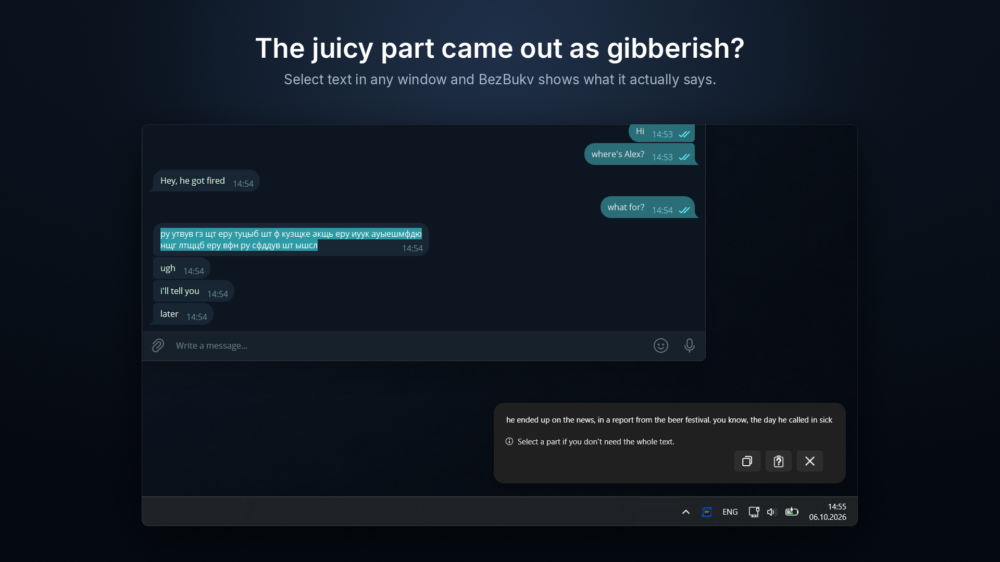
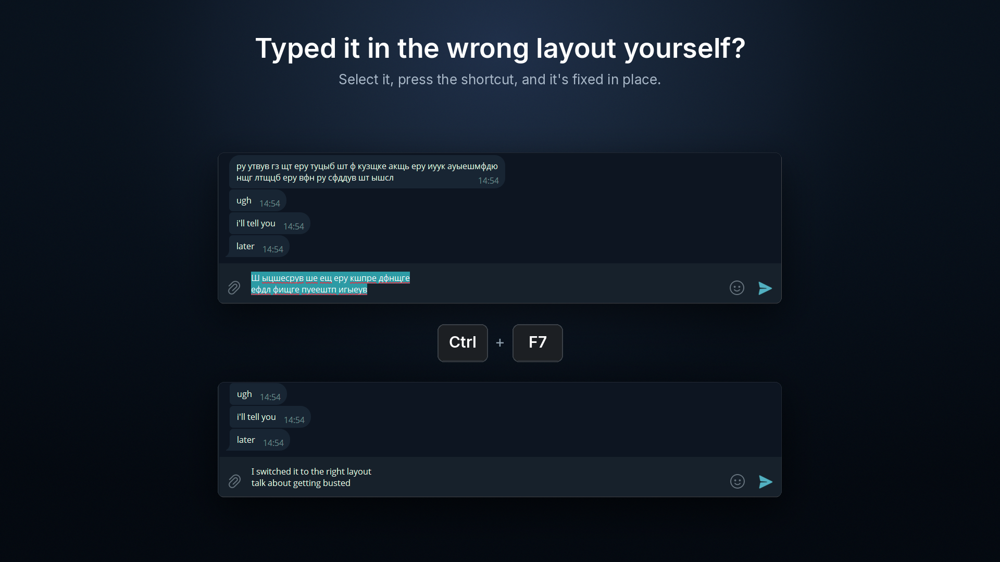
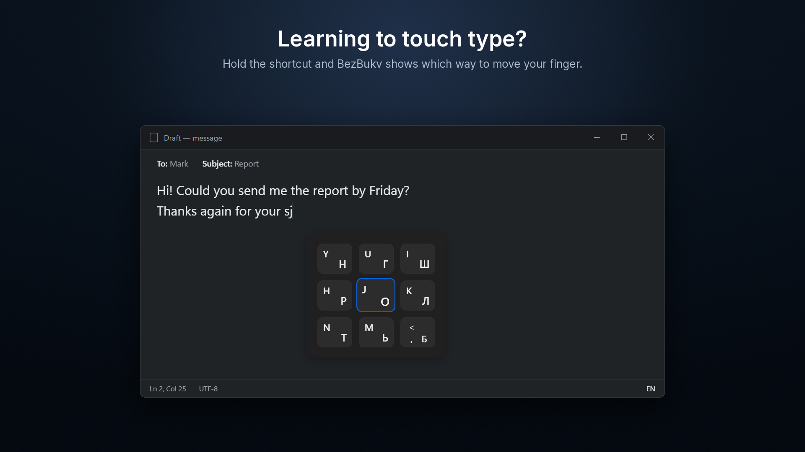
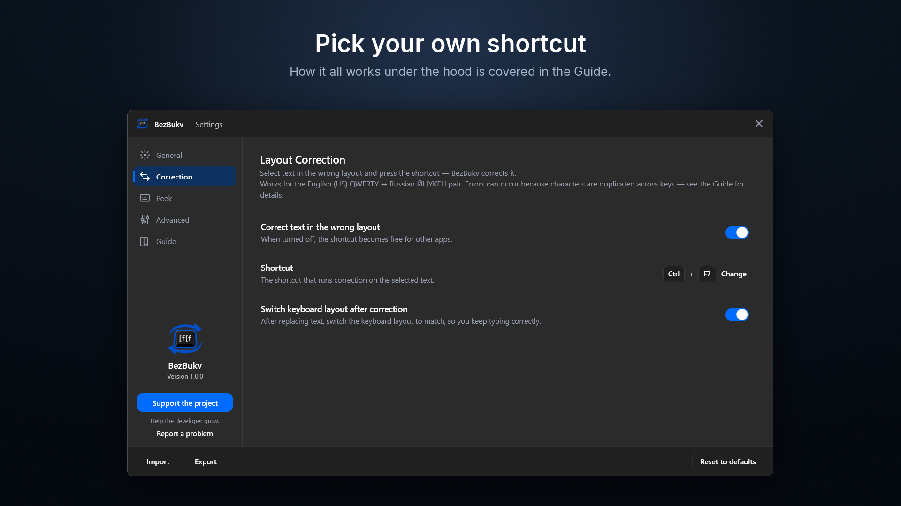
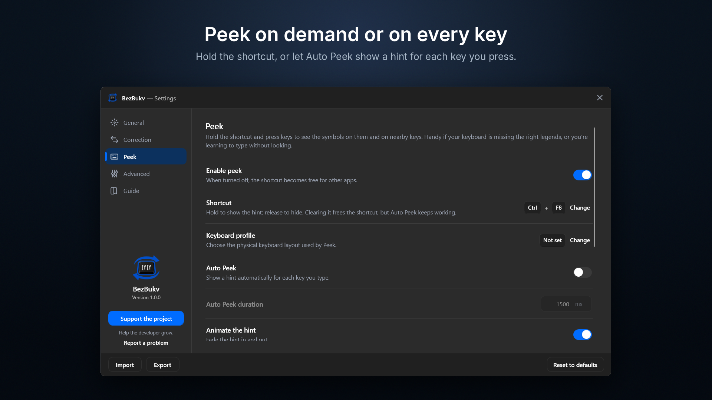

English | [Русский](README.ru.md)

# BezBukv

BezBukv is your keyboard assistant. It lives in the notification area, stays out of your way, and helps when something goes wrong with typing.

Typed a paragraph in the wrong layout? Select it and press the hotkey: the text will be corrected between English (US) and Russian layouts, and if desired, the layout will switch itself, so you can continue typing normally. No internet or AI required, everything is done using built-in tables right on your computer, and nothing is sent anywhere.

BezBukv can also show key hints. Engraving worn off? Missing the right layout on the keys? Learning touch typing? A card on the screen will show where the right key is, so you don't have to look for it on the keyboard.







## Download and install

Get the latest installer from [Releases](https://github.com/bzrworks/BezBukv/releases). Any PC running Windows 10 or Windows 11 (x64) will do. You don't need an internet connection or administrator rights to install it — everything it needs, including .NET, is already inside.

The installer isn't digitally signed yet, so Windows security may be cautious about it. If you see "Windows protected your PC", click "More info" and then "Run anyway".

Windows 11 has one more safeguard — Smart App Control. On many PCs it's turned off, and then it doesn't affect you. If it's on, it blocks unsigned apps, including BezBukv, with no way to run them anyway. You can turn it off in Windows Security, but be aware that on some versions of Windows 11 the only way to turn it back on is to reinstall Windows. So only turn it off if you're sure.

## Privacy

BezBukv never goes online and never sends anything anywhere. See the [privacy policy](https://bzrworks.com/bezbukv/privacy/) for details.

## Build from source

You'll need the [.NET 10 SDK](https://dotnet.microsoft.com/download). Clone the repository and run this in its root folder:

```powershell
dotnet publish src\BezBukv.App -c Release -r win-x64 --self-contained -o publish
```

A `publish` folder will appear in the repository root with the ready-to-use app — run `BezBukv.App.exe`, no installation needed. You can move the folder wherever you like; .NET is already inside. The app keeps its settings separately, in `%LOCALAPPDATA%\BezBukv`.

### Installer

If you want a Start menu shortcut, an entry in your installed apps, and a clean uninstall that also removes autostart and, if you choose, your settings, build the installer. You'll also need [Inno Setup 7](https://jrsoftware.org/isinfo.php):

```powershell
powershell -NoProfile -ExecutionPolicy Bypass -File .\installer\build-installer.ps1
```

The installer will appear in the `installer\Output` folder.

## License

The source code is open for viewing. Anyone may use the app for any purpose, including commercial purposes. You may study the source code and build the app from it for your own use. Redistributing the app, modifying it, or creating derivative works based on it is not permitted. The exact terms are in [LICENSE](LICENSE).

## Get in touch

Found a bug, have a question or an idea? Write to me via the [feedback page](https://bzrworks.com/feedback).

If you like BezBukv or find it useful, you can [support the developer](https://bzrworks.com/support). And a star on the repository tells me that people are interested in BezBukv and it's worth developing further.
