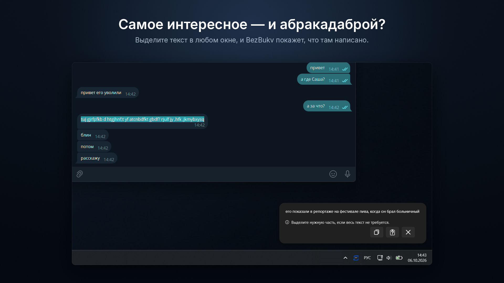
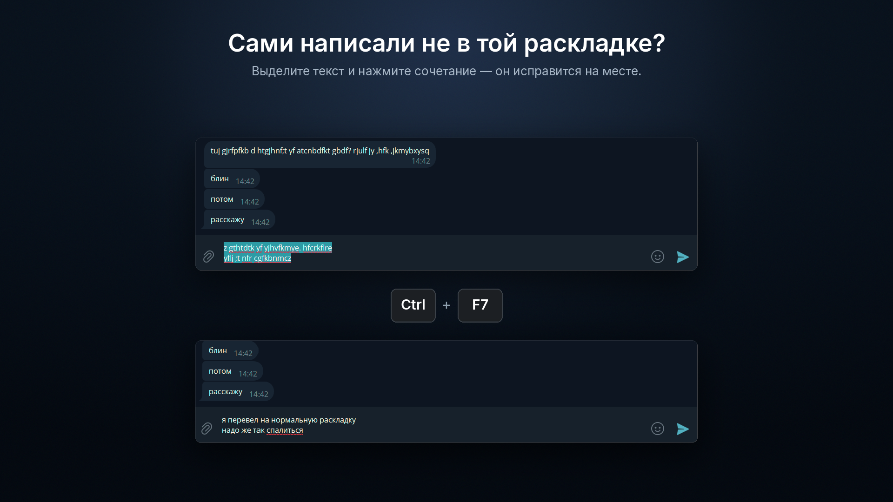
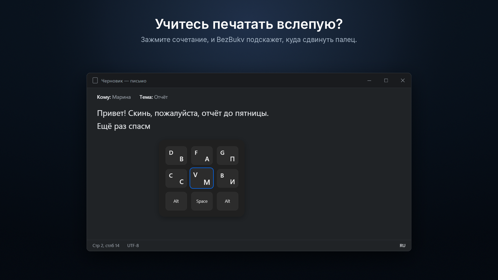
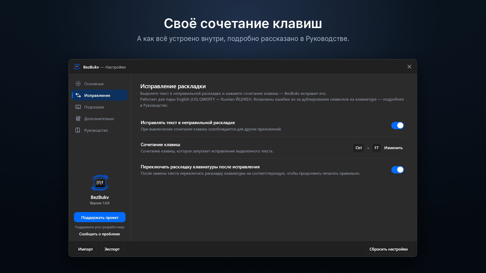
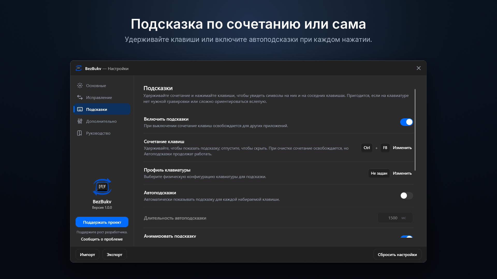

[English](README.md) | Русский

# BezBukv

BezBukv — ваш клавиатурный ассистент. Он живёт в области уведомлений, никак себя не навязывает и выручает, когда с клавиатурой что-то пошло не так.

Набрали абзац не в той раскладке? Выделите его и нажмите сочетание клавиш: текст будет исправлен между английской (US) и русской раскладками, а при желании раскладка сама переключится, и вы продолжите печатать как нужно. Для этого не нужны интернет и нейросети, всё делается по встроенным таблицам прямо на вашем компьютере, и ничего никуда не отправляется.

А ещё BezBukv умеет подсказывать клавиши. Стёрлась гравировка? Не хватает нужной раскладки на клавишах? Осваиваете слепую печать? Карточка на экране покажет, где нужная клавиша, чтобы не искать её глазами на клавиатуре.







## Скачать и установить

Установщик последней версии лежит в разделе [Releases](https://github.com/bzrworks/BezBukv/releases). Подойдёт любой компьютер с Windows 10 или Windows 11 (x64). Интернет и права администратора для установки не нужны — всё необходимое, включая .NET, уже внутри.

Установщик пока не подписан цифровой подписью, поэтому защита Windows может насторожиться. Если появится окно «Windows защитила ваш компьютер», нажмите «Подробнее», а затем «Выполнить в любом случае».

В Windows 11 есть ещё одна защита — Smart App Control. На многих компьютерах она выключена, и тогда вас это не касается. Если же она включена, то блокирует неподписанные программы, в том числе BezBukv, без возможности запустить их в обход. Её можно отключить в «Безопасности Windows», но учтите: в некоторых версиях Windows 11 включить её обратно можно только переустановкой системы. Поэтому отключайте её, только если уверены.

## Конфиденциальность

BezBukv не выходит в интернет и ничего никуда не отправляет. Подробнее — в [политике конфиденциальности](https://bzrworks.com/ru/bezbukv/privacy/).

## Сборка из исходного кода

Понадобится [.NET 10 SDK](https://dotnet.microsoft.com/download). Склонируйте репозиторий и выполните в его корне:

```powershell
dotnet publish src\BezBukv.App -c Release -r win-x64 --self-contained -o publish
```

В папке `publish` в корне репозитория появится готовая программа — запускайте `BezBukv.App.exe`, устанавливать ничего не нужно. Папку можно переместить куда удобно; .NET уже внутри. Настройки программа хранит отдельно, в `%LOCALAPPDATA%\BezBukv`.

### Установщик

Если хотите, чтобы появились ярлык в меню «Пуск» и запись в списке установленных приложений, а удаление проходило аккуратно — вместе с автозапуском и, по желанию, настройками, — соберите установщик. Понадобится ещё [Inno Setup 7](https://jrsoftware.org/isinfo.php):

```powershell
powershell -NoProfile -ExecutionPolicy Bypass -File .\installer\build-installer.ps1
```

Готовый установщик появится в папке `installer\Output`.

## Лицензия

Исходный код открыт для просмотра. Пользоваться программой разрешено всем и для любых целей, включая коммерческие. Исходный код можно изучать и собирать из него программу для собственного использования. Распространять программу, изменять её и создавать на её основе производные работы запрещено. Точные условия — в файле [LICENSE](LICENSE).

## Связаться и поддержать

Нашли ошибку, появился вопрос или идея — напишите через [страницу обратной связи](https://bzrworks.com/ru/feedback).

Если BezBukv вам понравился или пригодился, можно [поддержать разработчика](https://bzrworks.com/ru/support). А звёздочка репозиторию подскажет мне, что BezBukv интересен людям и его стоит развивать дальше.
